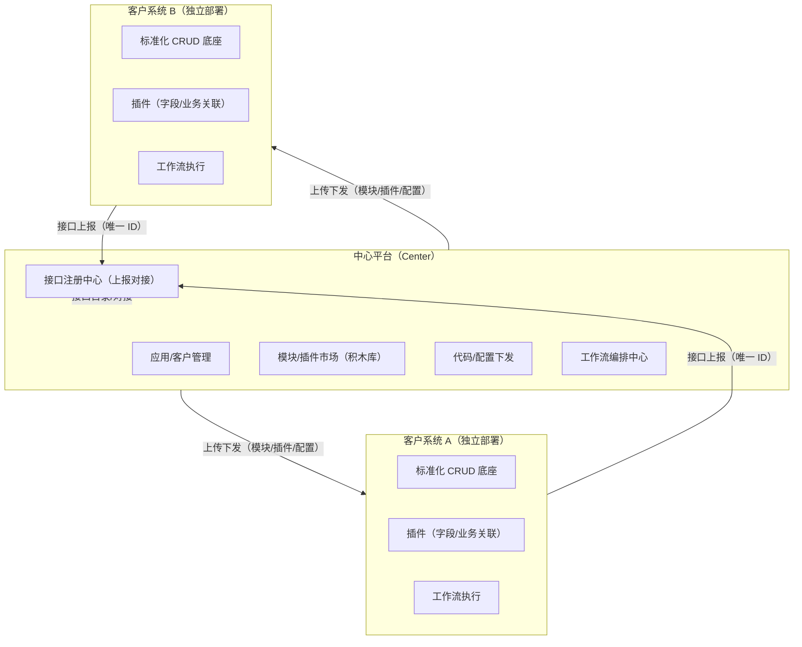
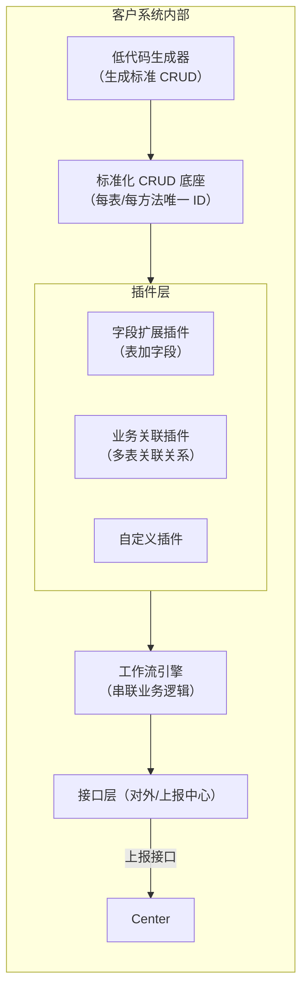
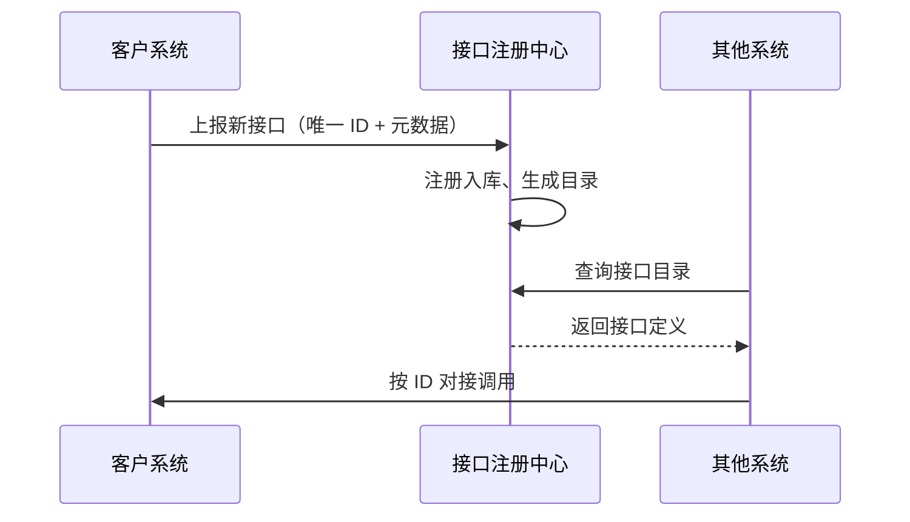
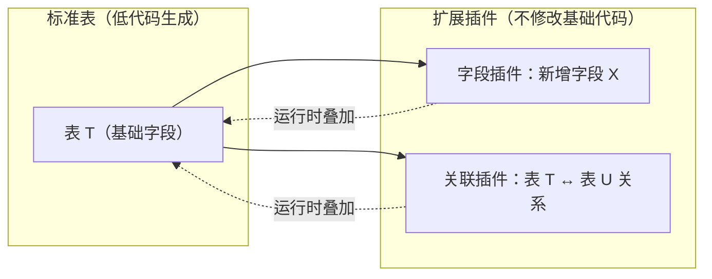
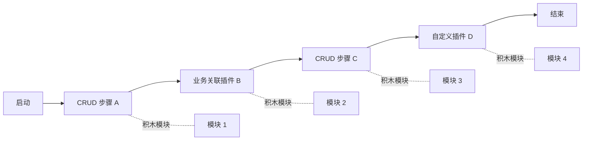

# 积木式可插拔系统架构设计

> 愿景：去单体化，用「中心平台 + 独立客户系统 + 标准化 CRUD + 插件扩展 + 工作流编排」实现代码隔离与积木拼接。

## 一、整体拓扑（中心 + 节点 + 积木）

## 二、客户系统内部架构（标准化 CRUD + 插件 + 工作流）

## 三、接口注册 / 上报机制

## 四、插件机制（字段扩展 / 业务关联）

## 五、工作流编排（积木拼接）

---

## 核心设计要点

| 维度 | 方案 | 解决什么 |
|------|------|---------|
| 代码隔离 | 中心 + 独立客户系统，上传下发 | 单体多租户代码泄漏 |
| 标准化 CRUD | 低代码生成，唯一 ID | 接口可识别、可上报、可对接 |
| 字段扩展 | 字段扩展插件（运行时叠加） | 表加字段不改基础代码 |
| 业务关联 | 关联插件（多表关系） | 复杂业务逻辑不堆在单体里 |
| 编排 | 工作流引擎串联 | 业务逻辑可视化、可编排 |
| 积木拼接 | 模块/插件化，任意组合 | 多系统灵活组装 |

---

## 相关

- **项目文档索引** — 上级 MOC
